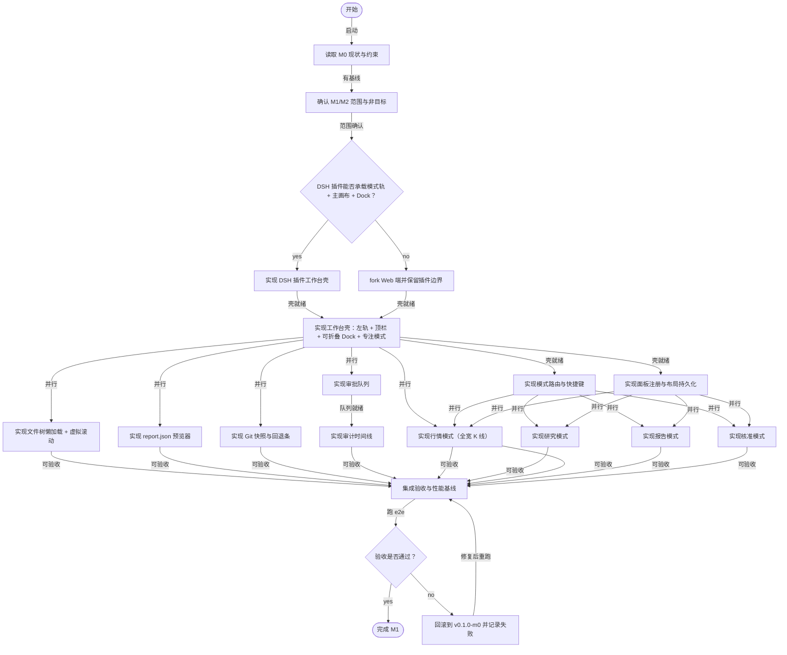

# M1/M2 工作台壳、模式切换与假设核准闭环

放弃固定四栏，改为「左侧模式轨 + 单主画布 + 可折叠 Dock」：研究/行情/文件/报告/核准/看板六个模式通过左轨与快捷键切换，每个模式内部用可折叠面板组合；K线作为独立行情模式获得整屏宽度，研究模式只保留底部迷你K线。聊天默认左侧 Dock，检查器默认右侧 Dock，Focus 模式隐藏全部 Dock。

> 从当前会话蓝图导出。`m1-m2-workbench.json` 是可被 `blueprint(action="create")` 直接使用的 payload。

## 层

- **A** 总览（父模块：`—`）
- **B** 工作台壳与模式（M1）（父模块：`m1-workbench`）
- **C** 核准模式（M2）（父模块：`m1-workbench`）
- **D** 验证与交付（父模块：`m1-workbench`）

## 需求

### 目标

| 编号 | 条目 | 模块 |
|---|---|---|
| R1 | 在 DSH Web 内落地可运行的工作台：模式轨 + 主画布 + 可折叠 Dock，取代固定四栏。 | layout-shell |
| R2 | 文件树支持 sources/analysis/deliverables 三根分区，单层懒加载 + 虚拟滚动。 | file-tree |
| R3 | 报告画布支持 report.json 的 text/chart/table 块，iframe 沙箱隔离。 | preview |
| R4 | 假设核准走通 draft→frozen，带证据、可证伪条件与审计事件。 | approval-queue |
| R5 | 每个 agent turn 自动 Git 快照，UI 可查看最近 20 个版本并回退。 | versions |
| R40 | 行情作为独立模式：全宽 K 线、成交量、MA/MACD/RSI；研究模式只保留底部迷你 K 线。 | market-panel |
| R48 | 用模式切换 + 面板折叠承载页面切换，替代四个固定栏；切回保留滚动、选中与布局。 | mode-router |

### 功能

| 编号 | 条目 | 模块 |
|---|---|---|
| R11 | 工作台壳：左侧 56px 模式轨 + 顶栏 + 主画布 + 可折叠 Dock + 状态栏。 | layout-shell |
| R12 | 对话 Dock 复用 DSH session，默认左侧 320px，可折叠/换边/浮层。 | layout-shell |
| R13 | 核准模式：待审队列 + 假设详情 + 审计时间线，支持批准/修改后批准/驳回。 | approval-mode |
| R14 | 文件树作为可折叠面板：面包屑、搜索、右键菜单、版本徽标。 | file-tree |
| R15 | 报告模式：大纲 + 块级预览/编辑 + 属性/评论；源码作为高级 Tab。 | report-mode |
| R16 | 版本面板显示最近 20 个 Git 快照、diff 摘要与一键回退。 | versions |
| R17 | 审批状态变更写 append-only 事件，UI 显示操作者、时间与依据。 | approval-flow |
| R18 | 所有面板通过统一 Workspace API 读取文件与版本，不直连宿主机。 | file-tree |
| R41 | 行情模式：自选/搜索 + 全宽 K 线 + 标的详情；日/周/月/分钟周期。 | market-panel |
| R42 | K 线支持十字光标、成交量、MA/MACD/RSI 切换与 as-of 时间。 | market-panel |
| R43 | K 线数据来自行情服务快照，前端禁止直连数据源；缺数据标注 n.a.。 | market-panel |
| R49 | 左轨模式切换：研究/行情/文件/报告/核准/看板；快捷键 1–6。 | mode-router |
| R50 | 研究模式 = 文件树 + 报告画布 + 假设检查器 + 左侧对话 Dock + 底部迷你 K 线。 | research-mode |
| R51 | 面板可折叠、换边、拖拽宽度；Focus 模式隐藏所有 Dock，Esc 退出。 | panel-registry |
| R52 | 深链：#/research/:id、#/market/:symbol、#/report/:id?tab=preview，刷新恢复现场。 | mode-router |

### 非功能

| 编号 | 条目 | 模块 |
|---|---|---|
| R19 | 1280×800 下研究模式可用；<1024 单 Dock 抽屉；<780 单列只读。 | — |
| R20 | 1,000 个文件的目录首屏 < 2s，滚动 60fps。 | — |
| R21 | 面板交互 p95 < 100ms；流式期间不阻塞输入。 | — |
| R22 | 本地优先：默认 SQLite + 本地 Git，可替换 Postgres/对象存储。 | — |
| R23 | 所有工具调用与审批可审计；不在前端暴露密钥。 | — |
| R44 | 10,000 根 K 线首屏 < 1s，缩放/平移 60fps；行情模式展开 < 100ms。 | — |
| R53 | 模式切换与面板折叠 < 100ms；切回保留滚动位置、选中项与宽度。 | — |
| R54 | 模式/面板状态按 workspace + mode 持久化；提供“重置布局”。 | — |

### 约束

| 编号 | 条目 | 模块 |
|---|---|---|
| R24 | DSH 0.2.x，client plugin API 可能不足，允许 fork Web 端（MIT）。 | — |
| R25 | 前端 React 18 + TypeScript；布局用 react-resizable-panels。 | — |
| R26 | 领域服务 FastAPI + Pydantic v2；MVP 用 SQLite。 | — |
| R27 | 不引入第二套 agent 编排器；审批是状态机，不是 agent。 | — |
| R28 | 不提交真实客户数据/未授权行情；样例必须标注 synthetic。 | — |
| R29 | Apache-2.0；新增依赖先过许可证检查。 | — |
| R45 | 行情图优先 ECharts；若 10k 根性能不足再评估 klinecharts（Apache-2.0）。 | — |
| R55 | 不用 qiankun/微前端；用 React.lazy + panel registry 做模块边界。 | — |
| R56 | 样式用 DSH CSS tokens + CSS Modules，不引 Ant Design/Tailwind。 | — |
| R57 | 废弃固定四栏；对话默认左 Dock，检查器默认右 Dock，允许换边。 | — |

### 验收

| 编号 | 条目 | 模块 |
|---|---|---|
| R30 | 研究模式在 1280px 下可用，折叠/恢复不丢状态。 | — |
| R31 | 文件树加载 1k 文件 < 2s，滚动无明显卡顿。 | — |
| R32 | 报告画布正确渲染 text/chart/table 三种块，iframe 无法访问父页面。 | — |
| R33 | 一条假设从 draft 走到 frozen，审计事件 5 条且顺序正确。 | — |
| R34 | 最近 20 个 Git 快照可查看/回退，回退后 e2e 可重跑。 | — |
| R46 | 行情模式 K 线 + 成交量 + MA/MACD/RSI 正确渲染，10k 根 < 1s。 | — |
| R58 | 模式切换 < 100ms；刷新后恢复模式、面板布局与选中项。 | — |
| R59 | Focus 模式隐藏所有 Dock；Esc 恢复；窄屏无横向滚动。 | — |

### 风险

| 编号 | 条目 | 模块 |
|---|---|---|
| R35 | DSH 插件插槽不足，四栏需 fork，带来上游合并成本。 | — |
| R36 | 文件树/报告画布在低配机器上性能不达标。 | — |
| R37 | 审批语义被聊天记录稀释，用户绕过队列。 | — |
| R38 | Git 快照频率过高导致仓库膨胀。 | — |
| R39 | 报告 iframe 的 XSS/越权风险。 | — |
| R47 | 行情数据授权/实时性、K 线渲染性能。 | — |
| R60 | 模式切换时组件卸载重建，导致滚动/选中/布局丢失。 | — |
| R61 | 窄屏 Dock 层叠，导致主画布不可用。 | — |

### 角色与场景

| 编号 | 条目 | 模块 |
|---|---|---|
| R6 | 分析师：发起研究、浏览文件、查看报告。 | — |
| R7 | 审批人：核准/驳回假设，填写条件。 | — |
| R8 | DSH Lead Agent：规划、调用子智能体、写工作区。 | — |
| R9 | 数据/估值子智能体：只读数据、运行受限代码。 | — |
| R10 | 系统管理员：配置数据源、权限与审计。 | — |

## 模块

| 编号 | 模块 | id | 层 | 依赖 | 文件 | 验收 |
|---|---|---|---|---|---|---|
| A1 | M1/M2 工作台总控 | `m1-workbench` | A | — | apps/workbench/** docs/roadmap.md | 六模式工作台在 1280px 可用 M1/M2 验收清单完成 |
| B1 | DSH 承载能力 spike | `dsh-spike` | B | — | spikes/dsh-workbench/** docs/adr/0003-dsh-plugin-vs-fork.md | spike 结论明确：插件或 fork demo 可加载或 fork 构建通过 |
| B2 | 工作台壳（左轨 + 顶栏 + Dock） | `layout-shell` | B | `dsh-spike` | apps/workbench/src/shell/** apps/workbench/src/styles/tokens.css | 模式轨/顶栏/状态栏可用 Dock 折叠/换边/宽度持久化 Focus 模式隐藏 Dock |
| B7 | 模式路由与快捷键 | `mode-router` | B | `layout-shell` | apps/workbench/src/modes/registry.ts apps/workbench/src/router/** | 模式切换 <100ms 刷新恢复现场 切回保留滚动/选中 |
| B8 | 面板注册与布局持久化 | `panel-registry` | B | `layout-shell` | apps/workbench/src/layout/** apps/workbench/src/state/layoutStore.ts | 面板注册/折叠/换边 布局持久化 重置布局可用 |
| B3 | 文件树面板 | `file-tree` | B | `layout-shell` | apps/workbench/src/features/file-tree/** services/domain/app/workspace.py packages/contracts/workspace.schema.json | 1k 文件首屏 <2s 三根分区与版本徽标 搜索/面包屑可用 |
| B4 | 报告画布 | `preview` | B | `layout-shell`, `file-tree` | apps/workbench/src/features/preview/** packages/contracts/report.schema.json | 三种块正确渲染 iframe 无法访问父页面 块级选中可用 |
| B5 | Git 快照与回退面板 | `versions` | B | `layout-shell` | apps/workbench/src/features/versions/** services/domain/app/versions.py | 最近 20 版可见 回退后 e2e 可重跑 不 hard reset |
| B6 | 行情模式（全宽 K 线） | `market-panel` | B | `mode-router`, `panel-registry` | apps/workbench/src/modes/market/** services/domain/app/market.py packages/contracts/market.schema.json | K线+成交量+MA/MACD/RSI 10k 根 <1s，缩放平移 60fps 折叠/切模式不丢状态 |
| B9 | 研究模式 | `research-mode` | B | `mode-router`, `panel-registry`, `file-tree`, `preview` | apps/workbench/src/modes/research/** | 1280px 三栏可用 对话 Dock 可折叠 迷你K线可展开到行情模式 |
| B10 | 报告模式 | `report-mode` | B | `mode-router`, `panel-registry`, `preview` | apps/workbench/src/modes/report/** | 块级编辑 属性/评论 源码 Tab |
| B11 | 核准模式 | `approval-mode` | B | `mode-router`, `panel-registry`, `approval-queue` | apps/workbench/src/modes/approval/** | 队列→详情→审批 审计时间线 驳回原因码 |
| C1 | 假设核准队列 | `approval-queue` | C | `layout-shell` | apps/workbench/src/features/approval/** services/domain/app/approval.py | 队列可筛选 under_review 三种审批动作可用 驳回带原因码 |
| C2 | 状态机与审计时间线 | `approval-flow` | C | `approval-queue` | apps/workbench/src/features/approval/state/** services/domain/app/approval.py | draft→frozen 走通 审计事件 5 条且顺序正确 批准冻结版本 |
| D1 | 端到端验收与性能基线 | `e2e-verify` | D | `layout-shell`, `mode-router`, `panel-registry`, `file-tree`, `preview`, `versions`, `market-panel`, `research-mode`, `report-mode`, `approval-mode`, `approval-queue`, `approval-flow` | tests/e2e/** docs/acceptance/m1.md | e2e 全绿 模式切换<100ms 性能/安全基线记录 失败可回滚到 v0.1.0-m0 |
| D2 | CI/构建/文档 | `ci-build` | D | `layout-shell`, `mode-router` | .github/workflows/** apps/workbench/package.json docs/** | CI 构建 + 测试全绿 README/ADR 更新 |

## 图解

| 图 | 层 | 节点 | 连线 |
|---|---|---|---|
| 工作台用例 | A:usecase | 11 | 12 |
| 数据流 | A:dfd | 10 | 12 |
| 模块依赖 | A:module | 18 | 33 |
| 打开→预览→核准→快照 | A:sequence | 5 | 16 |
| 工作区数据模型 | A:er | 7 | 4 |
| C4 上下文/容器 | A:c4 | 10 | 10 |
| 核心类型 | A:class | 9 | 8 |
| 假设状态机 | A:state | 9 | 10 |
| 实施计划 | A:flowchart | 25 | 36 |

## 实施计划图

## 推进顺序

1. **B1** DSH 承载 spike → ADR 0003（插件 vs fork）
2. **B2** 工作台壳 → **B7** 模式路由 + **B8** 面板注册
3. **B3** 文件树 / **B4** 报告画布 / **B5** 版本 / **B6** 行情模式
4. **B9** 研究模式 / **B10** 报告模式 / **B11** 核准模式
5. **C1** 核准队列 → **C2** 状态机/审计
6. **D1** e2e / **D2** CI

## 使用方式

- 新会话读取 `m1-m2-workbench.json`，用 `blueprint(action="create")` 重建。
- 用户确认与分派只能由「蓝图」面板发起；不要调用 `blueprint confirm` / `dispatch`。
- 每个模块的 `tests / reviewer / human` 三层验证由用户 `/blueprint verify` 记录；任一层 failed → `needs-rework`，三层 passed → `done`。
- 子代理提示词必须包含模块范围、依赖、验收标准与相关图表中的接口/数据流。

